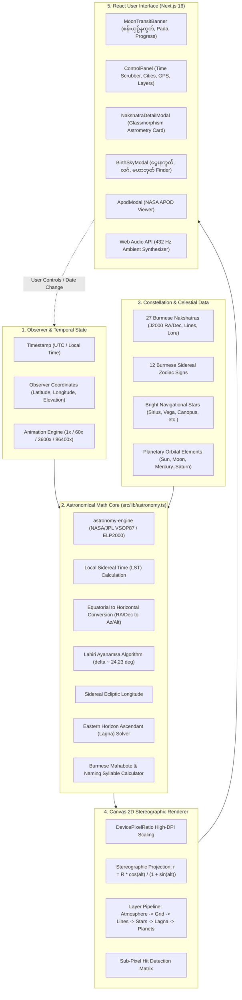
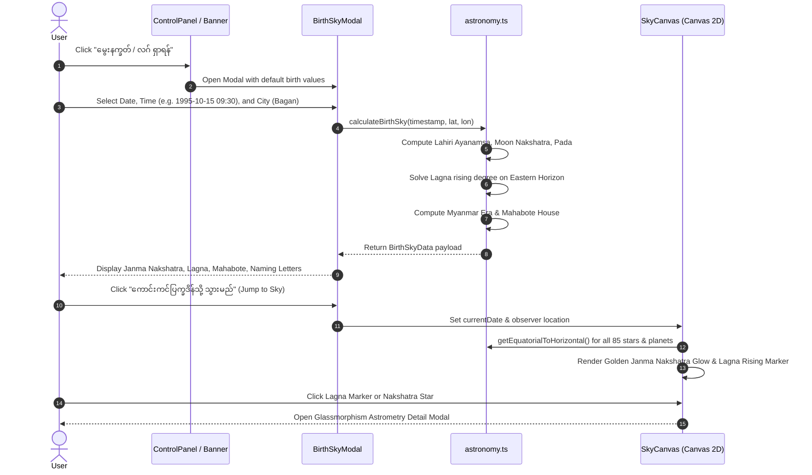

# 🌌 NakshatraMM (နက္ခတ်မြန်မာ)
### *Burmese Sky & Astronomical Simulator · မြန်မာ့ရိုးရာ နက္ခတ် ၂၇ လုံး နှင့် ကောင်းကင်ပြက္ခဒိန်*

[](https://nextjs.org/)
[](https://www.typescriptlang.org/)
[](https://tailwindcss.com/)
[](https://github.com/cosinekitty/astronomy)
[](LICENSE)

---

## 📖 Overview

**NakshatraMM (နက္ခတ်မြန်မာ)** is a production-grade, interactive astronomical web application designed for amateur stargazers, astrophotographers, and Burmese traditional astronomy/astrology enthusiasts. It bridges modern high-precision celestial mechanics (NASA/JPL planetary ephemeris) with indigenous Burmese celestial heritage spanning over a millennium.

By computing observer-centric horizontal coordinates in real time, the platform projects the night sky onto a responsive 360-degree stereographic sky dome. It overlays the traditional **27 Burmese Nakshatras (နက္ခတ် ၂၇ လုံး)**, **12 Sidereal Zodiacs (၁၂ ရာသီခွင်)**, real-time Moon Nakshatra transit (**စန်းယှဉ်နက္ခတ်**), and the rising **Eastern Horizon Lagna (လဂ် / Ascendant)** alongside major navigational stars and naked-eye solar system planets.

---

## ✨ Key Features

### 1. 🌌 Full-Bleed Edge-to-Edge Spatial Canvas & Floating Glassmorphism HUD
- **Spatial Map Architecture (Google Maps / Star Walk UI):** The celestial canvas renders full-bleed at `100vw × 100dvh` behind all interface elements (`fixed inset-0 z-0`). Users can drag, rotate, pinch, and zoom stars anywhere across the screen, including behind translucent frosted glass cards.
- **Floating Glassmorphism Overlay:** Translucent frosted glass headers, banners, and docks (`bg-slate-950/45 backdrop-blur-md border-white/10`) allow cosmic stars and planets to visibly drift behind them while keeping interface controls crisp.
- **Collapsible Moon Transit Pill:** The real-time transit banner smoothly collapses into a sleek compact pill (`🌙 စန်းယှဉ်: စိတြ · ပါဒ် ၃ · 73% ▾`) to maximize starry sky visibility, or expands into the full astrometric telemetry card.
- **Right-Edge Spatial Controls:** Compact vertical stack for Zoom In/Out, 360° Compass Needle Dial with degree readout, rotation steps, view reset, fullscreen immersion, and Zen Mode.
- **Floating Time-Travel Scrubber Dock:** Translucent dock floating at the bottom with 24-hour time scrubber slider, Play/Pause animation, speed cycling (**1x, 60x, 1h/s, 1d/s**), real-time reset, and quick layer toggles.
- **Zen Mode (`Z` key):** Seamlessly suppresses all HUD elements for pure, uninterrupted stargazing with an easy one-touch restore pill.
- **Slide-Over Settings Drawer:** Glassmorphism drawer for searching all 27 Nakshatras and 12 Zodiac signs, GPS geolocation, Myanmar city presets, and custom coordinates.

### 2. 🔭 High-DPI Stereographic Sky Dome & 360° Compass Rotation
- **Conformal Stereographic Projection:** Maps the full 360° celestial hemisphere without angular distortion near the zenith ($r = R \cdot \frac{\cos(\text{alt})}{1 + \sin(\text{alt})}$).
- **360° Free Azimuth Sky Rotation:** Freely rotate the celestial dome around the zenith using dragging, two-finger twist gestures, keyboard shortcuts (`[` and `]`), or dedicated rotation dial buttons (`↺`, `🧭 0°`, `↻`). Cardinal directions and celestial objects spin in exact mathematical synchrony.
- **Mobile Safe Perimeter (Zero Horizon Clipping):** Dynamically adjusts radial clearance ($R_{\text{max}} = \max(90, \min(W, H)/2 - 42)$) and utilizes `100dvh` viewport layout so North, East, South, and West cardinal labels and the full 360° horizon ring remain 100% visible on mobile portrait screens without any bottom cut-offs.
- **Responsive Label Scaling & Decluttering:** Font sizes smoothly clamp between 8px and 14px based on zoom level. Nakshatra shape subtitles (e.g., *မြင်းခေါင်းသဏ္ဌာန်, ဆင်စွယ်သဏ္ဌာန်*) progressively reveal when zooming in ($\ge 1.25\text{x}$) or selecting an object.
- **Altitude & Azimuth Grid:** Concentric rings at $30^\circ$ and $60^\circ$, zenith crosshair, and dual Burmese-English cardinal points (*မြောက် N, အရှေ့ E, တောင် S, အနောက် W*).
- **Sub-Pixel Hit Detection:** Hover and click on any star, constellation line, or planet to open glassmorphism detail cards displaying J2000 astrometric telemetry alongside classical Burmese lore.
- **X-Ray Earth Mode:** Toggle beneath-the-horizon viewing to inspect celestial bodies before they rise.

### 3. 🌟 Authentic Burmese Nakshatra Dataset (85 Stars, 67 Constellation Lines)
- Comprehensive catalog of all **27 Burmese Nakshatras** (*အဿဝဏီ / Ashwini* to *ရေဝတီ / Revati*).
- Astrometrically verified **J2000 Right Ascension (0–24h)** and **Declination ($-90^\circ$ to $+90^\circ$)** for all primary and multi-star stick-figure line segments.
- Cultural taxonomy including traditional Burmese shapes (*မြင်းခေါင်း, လှေငယ်, ဆင်စွယ်, ကျွဲဦးချို, ဝန်တင်လှည်း*), ruling planetary deities (*ဂြိုဟ်မင်း*), and mythology.

### 4. 🌙 Real-Time Moon Transit & Lahiri Ayanamsa Engine
- Calculates true **Sidereal Longitude** by deducting the high-precision **Lahiri Ayanamsa** ($\approx 24.23^\circ$) from tropical ephemeris coordinates.
- Displays the active **Transiting Nakshatra (စန်းယှဉ်နက္ခတ်)**, active **Pada (ပါဒ် ၁ မှ ၄)**, transit percentage progress bar, and Burmese lunar phase (*လဆန်း, လပြည့်, လဆုတ်, လကွယ်*).

### 5. 🧭 Birth Sky & Nakshatra Finder (မွေးနက္ခတ် နှင့် လဂ် ရှာဖွေရေး)
- Input birth date, birth time (24-hour precision), and Myanmar city preset or custom GPS coordinates.
- **Eastern Horizon Lagna (လဂ် / Ascendant):** Dynamically calculates and renders the exact sidereal zodiac sign and degree rising on the eastern horizon (`🌅 လဂ် (Lagna) · [Zodiac] [Deg]°`).
- **Janma Nakshatra (မွေးနက္ခတ်):** Highlights the native's birth constellation in glowing radiant gold.
- **Burmese Mahabote (မဟာဘုတ်):** Calculates the traditional Burmese house (*အဓိပတိ, အာယု, ရာဇ, အထွန်း, မရဏ, ဘင်္ဂ, သိုက်*) using the Myanmar Era calendar.
- **Naming Syllables & Day Guardian (နေ့နံ နှင့် မင်္ဂလာအက္ခရာများ):** Identifies auspicious naming consonants and planetary animal symbols.
- **Time Jump & Export:** Instantly jumps the interactive sky dome back to the birth moment and exports structured text records.

### 6. ⏳ Time-Travel & Geolocation Engine
- Smooth 24-hour time scrubber slider and historical calendar picker.
- Continuous animation loop with variable speed multipliers (**1x, 60x, 1h/sec, 1day/sec**).
- Myanmar city presets (*Yangon, Mandalay, Bagan, Taunggyi, Kalaw, Naypyidaw*) with HTML5 GPS Geolocation integration.

### 7. 🌌 NASA Astronomy Picture of the Day (APOD)
- Next.js server-side cached API route fetching NASA's daily high-resolution space highlight with Burmese translations.

### 8. 🎵 432 Hz Cosmic Ambient Synthesizer
- Built-in Web Audio API dual-oscillator ambient soundscape tuned to harmonic 432 Hz celestial resonance.

---

## 🏛 System Architecture

The following diagram illustrates the unidirectional data pipeline from ephemeris computation to canvas rendering and user interaction:



### User Interaction & Modal Data Flow



---

## 📐 Mathematical Foundations

### 1. Conformal Stereographic Projection with 360° Azimuth Rotation & Pan/Zoom

To map the 3D celestial sphere $(\text{azimuth}, \text{altitude})$ onto a planar 2D canvas of base radius $R_{\text{base}}$ centered at $(x_c, y_c)$ under interactive zoom $z \in [1.0, 4.0]$, azimuth rotation $\theta_{\text{rot}} \in [0^\circ, 360^\circ)$, and translation offset $(\Delta x, \Delta y)$, NakshatraMM evaluates:

$$R = R_{\text{max}} \cdot z, \quad \text{where } R_{\text{max}} = \max\left(90, \frac{\min(W, H)}{2} - 42\right)$$

$$r = R \cdot \frac{\cos(\text{alt})}{1 + \sin(\text{alt})}$$

where $\text{alt} \in [0^\circ, 90^\circ]$ is the celestial body's altitude. At the zenith ($\text{alt} = 90^\circ$), $r = 0$ (the center of the dome). At the horizon ($\text{alt} = 0^\circ$), $r = R$ (the bounding ring).

Applying the observer's azimuth rotation offset $\theta_{\text{rot}}$ and 2D pan offset $(\Delta x, \Delta y)$:

$$\theta = \left(\left(\text{az} + \theta_{\text{rot}}\right) \pmod{360^\circ} + 360^\circ\right) \pmod{360^\circ}$$

$$\begin{aligned}
x &= (x_c + \Delta x) - r \cdot \sin(\theta) \\
y &= (y_c + \Delta y) - r \cdot \cos(\theta)
\end{aligned}$$

> [!NOTE]
> When $\theta_{\text{rot}} = 0^\circ$ (North Up), an observer looks *upward* toward the celestial dome with North at the top ($\theta = 0^\circ$), East on the left ($\theta = 90^\circ$), and West on the right ($\theta = 270^\circ$). Rotating $\theta_{\text{rot}}$ smoothly spins the sky dome to face any desired cardinal direction without distorting angular relations.

---

### 2. Equatorial to Horizontal Coordinate Transformation

Given an observer's latitude $\phi$, longitude $L$, and local sidereal time $\theta_{\text{LST}}$, any celestial body with J2000 Right Ascension $\alpha$ and Declination $\delta$ has an Hour Angle:

$$\text{HA} = \theta_{\text{LST}} - \alpha$$

The local horizontal coordinates $(\text{alt}, \text{az})$ are solved via spherical trigonometry:

$$\sin(\text{alt}) = \sin(\delta) \sin(\phi) + \cos(\delta) \cos(\phi) \cos(\text{HA})$$

$$\tan(\text{az}) = \frac{\sin(\text{HA})}{\cos(\text{HA}) \sin(\phi) - \tan(\delta) \cos(\phi)}$$

---

### 3. Sidereal Zodiac & Lahiri Ayanamsa Conversion

Due to the precession of the Earth's rotational axis ($\approx 50.29''$ per year), the vernal equinox shifts continuously relative to the fixed sidereal stars. To convert tropical celestial coordinates ($\lambda_{\text{tropical}}$) to the Vedic/Burmese sidereal system ($\lambda_{\text{sidereal}}$), NakshatraMM evaluates the high-precision **Chitra Paksha / Lahiri Ayanamsa**:

$$A_{\text{Lahiri}}(t) = 23^\circ 51' 25.53'' + 50.29'' \cdot (t - 1900.0)$$

$$\lambda_{\text{sidereal}} = (\lambda_{\text{tropical}} - A_{\text{Lahiri}} + 360^\circ) \pmod{360^\circ}$$

The active Nakshatra index $k \in \{0, 1, \dots, 26\}$ and Pada $p \in \{1, 2, 3, 4\}$ are derived as:

$$k = \left\lfloor \frac{\lambda_{\text{Moon, sidereal}}}{13^\circ 20'} \right\rfloor = \left\lfloor \frac{\lambda_{\text{Moon, sidereal}}}{13.3333^\circ} \right\rfloor$$

$$p = \left\lfloor \frac{\lambda_{\text{Moon, sidereal}} \pmod{13.3333^\circ}}{3^\circ 20'} \right\rfloor + 1$$

---

### 4. Lagna (Ascendant) Rising Point on the Eastern Horizon

The **Lagna (လဂ်)** is the exact degree of the ecliptic rising above the eastern horizon at the moment and location of observation ($\text{alt} = 0^\circ$). The tropical ascendant longitude $\lambda_{\text{Asc, trop}}$ is derived from Local Sidereal Time ($\theta_{\text{LST}}$), observer latitude ($\phi$), and obliquity of the ecliptic ($\epsilon \approx 23.439^\circ$):

$$\tan(\lambda_{\text{Asc, trop}}) = \frac{\cos(\theta_{\text{LST}})}{-\sin(\theta_{\text{LST}}) \cos(\epsilon) - \tan(\phi) \sin(\epsilon)}$$

If the resulting point lies in the western hemisphere ($\text{azimuth} > 180^\circ$), $180^\circ$ is added so that it corresponds to the eastern horizon. The sidereal Lagna is then obtained by applying the Lahiri Ayanamsa:

$$\lambda_{\text{Asc, sidereal}} = (\lambda_{\text{Asc, trop}} - A_{\text{Lahiri}} + 360^\circ) \pmod{360^\circ}$$

$$\text{Zodiac Index} = \left\lfloor \frac{\lambda_{\text{Asc, sidereal}}}{30^\circ} \right\rfloor, \quad \text{Degree} = \lambda_{\text{Asc, sidereal}} \pmod{30^\circ}$$

---

### 5. Traditional Burmese Mahabote Equation

The **Mahabote (မဟာဘုတ်)** is computed using the native's Myanmar Era year ($ME$) and day of birth ($D \in \{1: \text{Sun}, 2: \text{Mon}, 3: \text{Tue}, 4: \text{Wed}, 5: \text{Thu}, 6: \text{Fri}, 0: \text{Sat}\}$):

$$\text{Myanmar Era Year } (ME) = \begin{cases} \text{Gregorian Year} - 638, & \text{if after Myanmar New Year (approx. mid-April)} \\ \text{Gregorian Year} - 639, & \text{otherwise} \end{cases}$$

$$\text{Remainder } R = (ME + D) \pmod 7$$

| Remainder ($R$) | Mahabote House | Burmese Name | Auspicious Meaning |
|---|---|---|---|
| $0$ | Bhanga | ဘင်္ဂ | Cleansing / Purification |
| $1$ | Marana | မရဏ | Resilience / Endurance |
| $2$ | Atun | အထွန်း | Luminosity / Radiance |
| $3$ | Yaza | ရာဇ | Nobility / Leadership |
| $4$ | Adhipati | အဓိပတိ | Authority / Supremacy |
| $5$ | Theik | သိုက် | Abundance / Prosperity |
| $6$ | Ayu | အာယု | Longevity / Vitality |

---

## 📂 Project Directory Structure

```plaintext
natkat/
├── .npmrc                               # Scoped network registry config
├── AGENTS.md                            # Next.js 16 agent rules & conventions
├── eslint.config.mjs                    # Modern flat ESLint configuration
├── next.config.ts                       # Next.js 16 configuration
├── package.json                         # Dependencies & scripts
├── tsconfig.json                        # Strict TypeScript compilation options
├── docs/
│   └── blog-post.md                     # Deep-dive dual-language engineering blog post
├── public/
│   ├── favicon.ico
│   └── ...                              # Static celestial assets
├── scripts/
│   └── verify-nakshatras.mjs            # Astrometric coordinate verification script
└── src/
    ├── app/
    │   ├── api/
    │   │   └── apod/
    │   │       └── route.ts             # Cached NASA APOD proxy endpoint
    │   ├── globals.css                  # Tailwind styles & Myanmar font definitions
    │   ├── layout.tsx                   # Root HTML wrapper & metadata
    │   └── page.tsx                     # Main interactive simulator container
    ├── components/
    │   ├── ApodModal.tsx                # NASA Astronomy Picture of the Day modal
    │   ├── BirthSkyModal.tsx            # Birth Sky, Lagna & Mahabote finder modal
    │   ├── ControlPanel.tsx             # Time scrubber, city picker, layer toggles
    │   ├── MoonTransitBanner.tsx        # Real-time transit, Pada & lunar day banner
    │   ├── NakshatraDetailModal.tsx     # Glassmorphism celestial telemetry card
    │   └── SkyCanvas.tsx                # Responsive High-DPI stereographic canvas
    ├── data/
    │   └── nakshatras.ts                # Complete 27 Nakshatras, Zodiacs & stars dataset
    └── lib/
        ├── astronomy.ts                 # Real-time ephemeris math & coordinate engine
        └── audio.ts                     # Web Audio API 432 Hz ambient drone synth
```

---

## 🚀 Quick Start & Installation

### Prerequisites
- [Node.js](https://nodejs.org/) v18.17+ or v20+ (tested on Node v24.15)
- [npm](https://www.npmjs.com/) v9+ (tested on npm 11.12)

### 1. Clone & Install Dependencies
```bash
git clone https://github.com/your-username/natkat.git
cd natkat
npm install
```

### 2. Run the Development Server
```bash
npm run dev
```
Open [http://localhost:3000](http://localhost:3000) in your browser.

### 3. Build & Run for Production
```bash
# Compile and optimize production build
npm run build

# Start production server
npm run start -- -p 3000
```

### 4. Run Astrometric Verification Script
Validate that all 27 Nakshatras, 85 stars, and 67 constellation lines have accurate J2000 RA/Dec bounds:
```bash
node scripts/verify-nakshatras.mjs
```

### 5. Deploy to Vercel (Production)

NakshatraMM is built with Next.js App Router and optimized for zero-configuration edge and serverless deployment on [Vercel](https://vercel.com):

#### Method A: Deploy via GitHub & Vercel Dashboard (Recommended)
1. Initialize git and push to GitHub:
   ```bash
   git init
   git add .
   git commit -m "feat: complete NakshatraMM simulator"
   git branch -M main
   git remote add origin https://github.com/<your-username>/nakshatramm.git
   git push -u origin main
   ```
2. Navigate to [Vercel Dashboard](https://vercel.com/new), import your repository, and click **Deploy**.
3. *(Optional)* Under **Environment Variables**, set `NASA_API_KEY` (automatically falls back to `DEMO_KEY` if omitted).

#### Method B: Instant Deploy via Vercel CLI
```bash
# 1. Run Vercel CLI & follow interactive login prompts
npx vercel

# 2. Deploy directly to production
npx vercel --prod
```

---

## ⚡ Performance & Engineering Highlights

- **Zero-Dependency High-DPI Canvas Rendering:** Canvas buffers are scaled dynamically by `window.devicePixelRatio` with crisp anti-aliased sub-pixel rendering.
- **Microsecond Spherical Coordinate Transforms:** Fast trigonometric approximations and vector projections enable the canvas to re-render at 60 FPS even when scrubbing time sliders.
- **Dual-Language Responsive Typography:** Hand-tuned CSS ensuring Burmese characters (`Noto Sans Myanmar`, `Padauk`) and Latin telemetry monospace fonts render with vertical metrics consistency.
- **Next.js 16 Partial Prerendering & Cache-Friendly APIs:** NASA APOD responses are cached using Next.js `fetch` cache segments (`revalidate: 3600`), minimizing network round-trips.

---

## 📜 Cultural References & Literature

1. **မင်းယဉ် မဟာနက္ခတ်ကျမ်း (Burmese Traditional Nakshatra Treatises)** — Astrological and astronomical observations of the Konbaung dynasty.
2. **U Pe Maung Tin (1923)** — *The Glass Palace Chronicle of the Kings of Burma*.
3. **NASA Jet Propulsion Laboratory (JPL)** — *HORIZONS Ephemeris System & Planetary Data System*.
4. **Lahiri, N.C. (1955)** — *Tables of the Sun and Ephemeris of the Moon*, Chitra Paksha Ayanamsa.

---

## 📄 License

This project is licensed under the **MIT License** — see the [LICENSE](LICENSE) file for details.
# nakat-project-two

